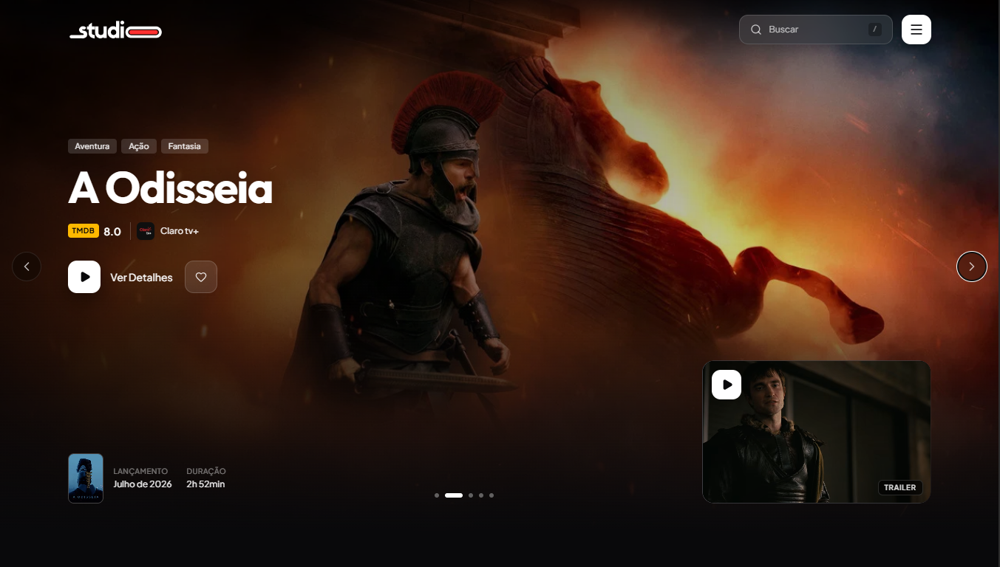
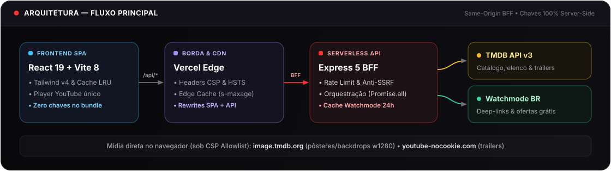
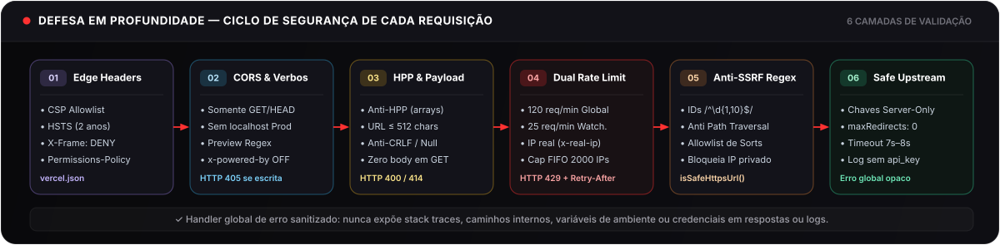

 

<a href="https://studiofilm.vercel.app" target="_blank">
  <picture>
    <source media="(prefers-color-scheme: dark)" srcset="frontend/public/logo-studio.png" />
    <source media="(prefers-color-scheme: light)" srcset="docs/logo-studio-light.png" />
    
  </picture>
</a>

 
 

  Plataforma editorial de descoberta de <strong>filmes, séries, artistas e streamings no Brasil</strong>, 
  com player YouTube unificado, deep-links BR e BFF Serverless na Vercel.

  
  

  
  
  
  
  

 

---

## ✨ O que o studio entrega

<table>
  <tr>
    <td width="50%" valign="top">
      <strong>🎬 Vitrine Viva &amp; Player Contínuo</strong> 
      Hero com transição atômica em 2 tempos, prévia de trailer que expande para tela cheia sem recarregar, grid de categorias, <code>TOP 10</code> arrastável e curadoria de aclamados 8.0+.
    </td>
    <td width="50%" valign="top">
      <strong>🧭 Explorar Unificado + Grátis no BR</strong> 
      Filmes e séries juntos ou separados, dock multi-seleção de 8 streamings no Brasil, filtro <strong>Grátis no BR</strong> (21 mil+ títulos), sliders de ano/nota e infinite scroll automático.
    </td>
  </tr>
  <tr>
    <td width="50%" valign="top">
      <strong>🎭 Detalhes, Artistas &amp; Deep-Links BR</strong> 
      Páginas completas de filmes, séries (com temporadas/episódios) e artistas (biografia + filmografia filtrável), com links diretos para abrir o título no streaming via Watchmode.
    </td>
    <td width="50%" valign="top">
      <strong>⚡ Busca Spotlight &amp; Surpreenda-me</strong> 
      Busca instantânea letra-a-letra (<code>/</code> ou <code>Ctrl+K</code>) com autocomplete inline (<code>Tab</code>), roleta inteligente de recomendações por clima e <strong>Minha Lista</strong> salva localmente.
    </td>
  </tr>
</table>

---

## 🏗️ Arquitetura

O frontend nunca fala direto com APIs privadas: todas as consultas passam por um **BFF Serverless em Express 5** na mesma origem (`/api/*`), que protege credenciais, aplica cache na borda da Vercel e combina dados do **TMDB** com os deep-links brasileiros da **Watchmode**.

  

> **Documentação interativa da API:** acesse o Swagger em **[studiofilm.vercel.app/api/docs](https://studiofilm.vercel.app/api/docs)** (especificação OpenAPI 3.0 em [`/api/openapi.json`](https://studiofilm.vercel.app/api/openapi.json)).

---

## 🧠 Decisões & Desafios

- **BFF Serverless em vez de chaves no frontend:** `API_KEY` e `WATCHMODE_API_KEY` ficam 100% no servidor. O endpoint `/api/hero` faz a agregação em paralelo (`Promise.all`) evitando múltiplas chamadas no navegador.
- **Hero instantânea (sem carregar "faixa por faixa"):** troca dos backdrops 4K (`original`) para `w1280` pré-decodificados na GPU (`img.decode()`), com transição atômica que sincroniza fundo, título e preview no mesmo frame.
- **Player de trailer único e sem UI do YouTube:** um único `<iframe>` (`youtube-nocookie.com`) expande do card para tela cheia sem recarregar o vídeo. Na Hero, um pool persistente aquece ~3.6s de cada trailer em RAM para trocar slides sem novas requisições, enquanto crop + gate de tempo escondem 100% do chrome do YouTube.
- **Streamings no Brasil & proteção de cota:** normalização de 18 plataformas BR mesclando logos do TMDB com links diretos e ofertas gratuitas da Watchmode — protegido por cache FIFO de 24h e rate limit dedicado (25 req/min) para preservar o plano gratuito.
- **Explorar fluido e completo:** modo unificado (`Todos | Filmes | Séries`), filtro **Grátis no BR**, sliders de ano e nota com debounce, busca letra-a-letra com `AbortController`, cache LRU em memória e infinite scroll automático (`IntersectionObserver`).

---

## 🛡️ Segurança

  

 

| Ameaça | Mitigação |
| :--- | :--- |
| **Vazamento de chaves** | Credenciais exclusivamente em `process.env` no servidor, `maxRedirects: 0` no Axios e logs sanitizados sem URLs/chaves. |
| **SSRF & Path Traversal** | Regex estrito em todos os IDs e filtros + `isSafeHttpsUrl()` bloqueando IPs privados, credenciais embutidas e portas fora da `443`. |
| **DoS / Exaustão de RAM** | Rate limiter dual (`120/min` global + `25/min` Watchmode) por IP real (`x-real-ip`) com teto FIFO de 2.000 buckets. |
| **HPP & Log Injection** | Bloqueio de métodos de escrita (`405`), parâmetros duplicados (`400`), URLs > 512 chars (`414`) e caracteres `\r\n\0`. |
| **XSS & Clickjacking** | Headers CSP restritivos, HSTS (2 anos + preload), `X-Frame-Options: DENY` e validação de chaves YouTube antes do iframe. |
| **Prototype Pollution** | `Object.create(null)` na leitura do `localStorage` e imagens travadas ao CDN oficial `image.tmdb.org`. |

---

  Feito por <a href="https://github.com/GabrielVSL"><strong>Gabriel VSL</strong></a> • <a href="https://studiofilm.vercel.app"><strong>studiofilm.vercel.app</strong></a>

